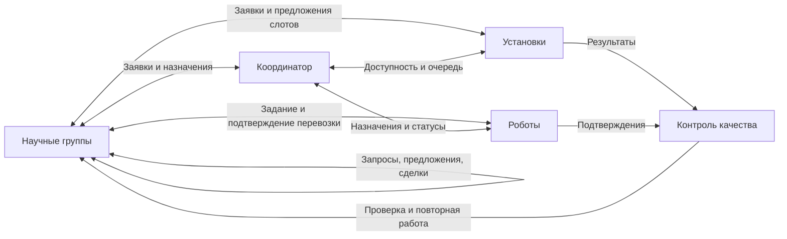
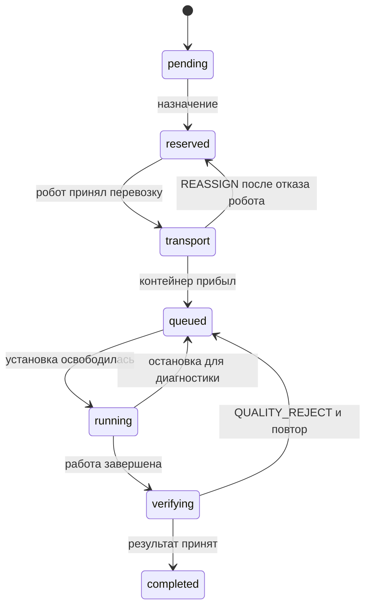

# Архитектура СПЕКТР

## Прикладная задача

Три научные группы должны выполнить набор исследований за ограниченную смену. Для каждого исследования нужны совместимая установка и перевозка контейнера. Установки и роботы ограничены по пропускной способности. Задачи имеют время появления, длительность, срок и ценность. Выполнение работы одной группы может задержать другую.

Модель описывает расписание, коммуникации и проверку программных обязательств. Предметные сущности вымышлены; контейнер и измерение — абстрактные объекты симуляции.

## Агенты и среда

| Участник | Собственная цель | Локальная информация | Действия |
| --- | --- | --- | --- |
| Научная группа | Завершить свои исследования с учётом ценности и сроков | Свои задачи, кредиты, полученные предложения и подтверждения | Запросить ресурс, выбрать предложение, предложить обмен, принять или отклонить сделку |
| Измерительная установка | Обслуживать подтверждённую очередь в пределах доступности | Совместимость, очередь, текущее состояние | Предложить слот, подтвердить назначение, начать и закончить работу |
| Робот | Выполнить назначенную перевозку | Положение, текущая задача, маршрут и доступность | Доставить контейнер, сообщить о ходе и завершении перевозки |
| Координатор | Выбрать допустимые назначения в центральном режиме | Заявки и объявленная доступность ресурсов | Назначить исполнителей, фиксировать решения |
| Контроль качества | Связать результат с действительным выполнением задачи | Состояния работ, происхождение результата, события проверки | Проверить сообщение, выявить недостоверный результат, запустить восстановление |

Точные параметры и формулы находятся в `dist/engine.js`. Краткая карточка каждого типа агента доступна на вкладке «Агенты».

Среда хранит часы симуляции, начальные задания, расположение помещений и действительные состояния ресурсов. Сообщение агента и факт среды различаются: сообщение «доставлено» само по себе не означает, что контейнер действительно прибыл. Это необходимо для испытания недостоверных сообщений.

## Граф коммуникаций

Граф показывает разрешённые смысловые связи. Он не означает наличие отдельных процессов или сетевых соединений: для воспроизводимого моделирования агенты выполняются в одном JS-процессе и общаются через явные сообщения.

## Состояние исследования

При повторном исследовании доставленный контейнер сохраняется. Истечение горизонта смены завершает прогон даже при наличии незавершённых работ. В журнале видны фактически выполненные переходы. Состояние `invalid` зарезервировано интерфейсным контрактом, но движок не использует его для переходов.

## Механизмы распределения

**Центральный режим (`central`).** Координатор собирает готовые задачи и объявленные состояния ресурсов, выбирает назначения по явному правилу, резервирует ресурсы и уведомляет участников.

**Контрактная сеть (`contract`).** Заявка инициирует сообщения запроса предложений (`CFP`), совместимые участники оценивают возможность исполнения (`BID`), выбранное предложение получает назначение (`AWARD`) и подтверждение (`ACK`). Время, очередь и стоимость координации учитываются средствами самой модели.

Оба режима работают на одном формате задач, с теми же роботами и установками. Один модуль не вызывает готовый внешний алгоритм диспетчеризации: правила распределения и сообщения записаны в исходном коде.

## Переговоры

Назначение задачи и переговоры — отдельные механизмы. Переговоры позволяют группам договариваться об изменении очередности за компенсацию. Группа оценивает выгоду для собственных исследований; получатель может отклонить предложение или потребовать другую компенсацию. Согласованное изменение применяется только после принятия условий обеими сторонами.

В журнале нужно различать предложение, встречное предложение, принятие и отказ. Результаты сравниваются с тем же распределением, но без этой возможности. Улучшение общей полезности не гарантирует улучшения справедливости.

## Испытания надёжности

Предусмотрены автоматические сценарии `normal`, `device`, `ghost`, `duplicate`, `misreport`. Ручной отказ робота доступен дополнительно. Проверяются недоступность ресурса, фиктивная бронь, повтор сообщения и ложное подтверждение результата. Защита включает проверки допустимого состояния, ограниченный срок резервирования, обработку повторов и восстановление после отказа. Конкретное поведение каждого сценария фиксируется сообщениями и событиями engine.

`protection=false` отключает моделируемые защитные правила, сохраняя базовую среду. Такой режим предназначен для сравнения: интерфейс может отображать принятые системой завершения, отличающиеся от действительных корректных результатов.

Экспорт трассы содержит конфигурацию, задания, сообщения, события и финальные показатели. Для анализа сбоя следует сопоставлять исходную заявку, назначение, подтверждение, фактический переход состояния и решение проверки.

## Ограничения модели

- Автономность моделируется правилами и локальным состоянием, а не генерацией текста LLM.
- Один процесс упрощает запуск и позволяет точно повторять порядок событий. Он не измеряет реальные задержки распределённой сети.
- Такт — условная единица. Скорость анимации не меняет длительность задания в тактах.
- Достоверность результатов задаётся состоянием учебной среды; это не физическая модель измерений.
- Выводы о механизмах зависят от нагрузки, правил полезности, величины ресурсов и выбранных сбоев.
